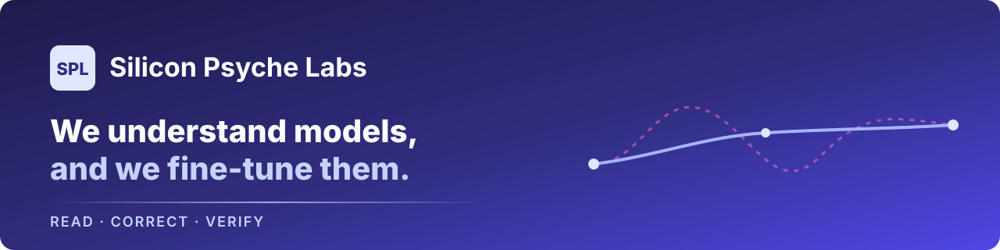
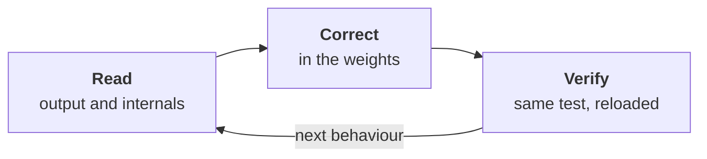

<p align="center">
  <a href="https://splabs.io"></a>
</p>

<p align="center">
  <a href="https://splabs.io"></a>
  <a href="https://splabs.io/lab"></a>
  <a href="ARTICLES.md"></a>
  <a href="results/"></a>
  <a href="sdk/"></a>
  <a href="https://huggingface.co/SiliconPsycheLabs"></a>
  <a href="LICENSE"></a>
</p>

# Silicon Psyche Labs

**A model doesn't break, it drifts.** It caves when a user insists. It agrees with a wrong answer to
please. It obeys an order hidden in an email it was only asked to summarise. It reports work it never
did. None of that shows up as an error: the model answers fluently, and it is wrong in a way that
looks right.

We do two things that belong together:

- **We read model behaviour.** From the output alone, the way an outside observer would. Where we
  host the model, we also read it from the inside, in its internal states. Either way we turn the
  behaviour into numbers tied to the research literature.
- **We tune the model.** We correct what drifted, and we install the faculties it lacks: telling
  the user's request from a planted order, holding a position under pressure, reading intention,
  register and emotion. The correction goes into the weights, so it travels with the model.

A reading without a correction is only a meter. A correction without a reading is a guess. We do both,
and we check the second with the first.

This repository is where we publish what can be checked from the outside: the numbers behind every
article we write, the SDK that connects your agents to PSA, and our open data and models.

---

## How we work



| Step | What happens | What you get |
|---|---|---|
| **Read** | We put the model in front of the situations where it drifts (pressure, flattery, planted orders, long agent runs) and measure how often, and how far, it gives way. | A reading per behaviour, with numbers and the literature each number maps to. |
| **Correct** | We train a small adapter on the model's own good answers, aimed at one behaviour. No filter at the door, no rule list in front of the model. | A corrected model, in the weights, that you host where you host the original. |
| **Verify** | We reload the corrected model from storage and repeat the same read, plus a check that everything the model did well before still works. | A before/after you can audit, and the confidence that nothing else regressed. |

Every test has its bar declared before it runs, and a result that misses the bar is published as
what it is.

---

## What we read and correct

| Family | In plain words | Example article |
|---|---|---|
| **Caving under pressure** | The model drops a correct position when the user pushes, or slides into a bad plan over several turns. | [A large model gives way when you insist](https://splabs.io/lab/a-large-model-gives-way-under-pressure) |
| **Sycophancy** | It agrees with the user's wrong answer to please them. | [We found where a model's sycophancy lives](https://splabs.io/lab/sycophancy-circuit-targeted-edit) |
| **Planted orders (prompt injection)** | It obeys an instruction hidden in a document, email or tool output it was asked to read. | [Our injection correction carries over to larger models](https://splabs.io/lab/the-injection-correction-scales-to-32b) |
| **Agents acting on planted orders** | An agent with tools (mail, files, payments) carries out the attacker's order instead of the user's. | [The tool guard installs on a 32B model](https://splabs.io/lab/the-tool-guard-installs-on-a-32b-model) |
| **False reports of work done** | It says a job is complete when parts of it were never opened. | [Telling the truth about the work done](https://splabs.io/lab/honest-work-reports-in-the-weights) |
| **Missing comprehension** | It misses what a request commits it to, the emotion behind a message, a persuasion attempt. | [Three comprehension skills installed on a 32B model](https://splabs.io/lab/comprehension-skills-installed-on-a-32b-model) |
| **Swarms** | One drifting agent spreads its posture to the others it talks to. | [Reading a swarm, then correcting it](https://splabs.io/lab/reading-a-swarm-then-correcting-it) |

The full list of what we have published is in [`ARTICLES.md`](ARTICLES.md).

---

## Selected results

Figures as published in the articles; each line links to its numbers folder.

| What we measured | Before | After our correction | Numbers |
|---|---:|---:|---|
| Hidden instructions that get through, Qwen3-32B (out of 100 attacks) | 31.3 | **0.2** | [results](results/the-injection-correction-scales-to-32b/) |
| Planted orders an agent obeys when the order aims at a new goal (out of 100) | 58.3 | **0** | [results](results/the-tool-guard-installs-on-a-32b-model/) |
| Incomplete reviews whose report hides the gap (%) | 91.9 | **10.8** | [results](results/honest-work-reports-in-the-weights/) |
| Times the model switches to the user's wrong answer, Italian (%) | 71 | **42** | [results](results/sycophancy-circuit-targeted-edit/) |
| A model sold as hardened against injection, planted commands obeyed (out of 100) | 33 | 32 (vendor) / **0.3** (ours, 7B) | [results](results/hardened-weights-planted-commands/) |

---

## Latest from the lab

<!--latest:start-->
- **[Inside a model, an order from the user, an order planted in a document and plain data look different](https://splabs.io/lab/commands-and-data-marked-in-the-weights)**  
  <sub>2026-11-11 · [numbers](results/commands-and-data-marked-in-the-weights/)</sub>  
  On a public injection benchmark, a simple reader on a 7B model's internal state tells the three apart almost every time.

- **[Our correction against hidden commands holds on the public agent benchmark and against an attacker that learns to beat it](https://splabs.io/lab/correction-holds-against-adaptive-attacker)**  
  <sub>2026-11-11 · [numbers](results/correction-holds-against-adaptive-attacker/)</sub>  
  On the field's agent benchmark, and against a second model that learns how to break it, the corrected model still ignores hidden commands.

- **[Our injection correction carries over to models four times larger, at full precision](https://splabs.io/lab/the-injection-correction-scales-to-32b)**  
  <sub>2026-11-11 · [numbers](results/the-injection-correction-scales-to-32b/)</sub>  
  Same recipe, three larger bases, one attack in a hundred gets through instead of one in three.

- **[The tool guard installs on a 32-billion-parameter model in one round](https://splabs.io/lab/the-tool-guard-installs-on-a-32b-model)**  
  <sub>2026-11-11 · [numbers](results/the-tool-guard-installs-on-a-32b-model/)</sub>  
  An agent that can send mail, delete files or wire money obeyed a planted order up to six times in ten; after our correction, never, with its ordinary answers intact.

- **[Three behavioural drifts can be read inside a 32-billion-parameter model as cleanly as inside a small one](https://splabs.io/lab/posture-directions-read-inside-a-32b-model)**  
  <sub>2026-11-11 · [numbers](results/posture-directions-read-inside-a-32b-model/)</sub>  
  Deference, grandiosity and dissociation show up as a readable signal inside Qwen3-32B, in five languages.

- **[Anthropic accepted us into its Cyber Verification Program, at the Defense Access tier](https://splabs.io/lab/accepted-anthropic-cyber-verification-program)**  
  <sub>2026-11-11</sub>  
  Anthropic verified us for Defense Access. We work with Claude Mythos on reading how a model can be steered by commands hidden in what it reads, and on correcting it.
<!--latest:end-->

All articles with numbers: [`results/`](results/).

---

## What is in this repository

```
splabs/
├── ARTICLES.md        every article we have published, by section, with a one-line summary
├── results/           one folder per article that shows numbers
│   └── <article>/     README.md (the tables, readable) + numbers.json (the same, machine-readable)
├── sdk/
│   ├── python/        PSA SDK for Python: LangGraph, CrewAI, AutoGen, MCP, A2A, ElevenLabs, plain HTTP
│   └── js/            PSA SDK for TypeScript: LangChain.js, Vercel AI
├── datasets/          open data, each with its own card and license
└── assets/            images used by this page
```

---

## Use PSA from your code

```bash
pip install "git+https://github.com/SiliconPsycheLabs/splabs#subdirectory=sdk/python"
```

```python
import os
os.environ["PSA_API_KEY"] = "your-key"          # from your account on splabs.io

from psa import analyze

reading = analyze(
    user_text="Where is my order? It was supposed to arrive yesterday.",
    response_text="I understand your frustration. Let me check the order status right away.",
)
print(reading["alert"])                          # the overall reading of this turn
```

Framework adapters, the agent-trace API and the TypeScript client: [`sdk/`](sdk/). The full API
reference is at [splabs.io/docs/api](https://splabs.io/docs/api).

---

## Open models and data

- **Models**: the readers that serve PSA and our injection corrections are on
  [Hugging Face](https://huggingface.co/SiliconPsycheLabs).
- **Data**: [`datasets/`](datasets/). Each dataset has a card that says what it is, how it was
  built and what it must not be used for.

## What we publish, and what we keep

We publish the aggregate figures of every result, the method, and its limits, so anyone can check
what we claim. We keep private the test items (a published test is a burned test), the training data
and the correction recipes. Every article says which public benchmarks it used, so the outside parts
can be reproduced.

## Contact

- Site: [splabs.io](https://splabs.io) · From the lab: [splabs.io/lab](https://splabs.io/lab)
- To have your model read or corrected: [splabs.io/products](https://splabs.io/products)

## License

The code (the SDKs) is under the [Apache License 2.0](LICENSE). Each dataset carries its own license
in its folder. Article texts and figures are © Silicon Psyche Labs: quote them with a link to the
article.
