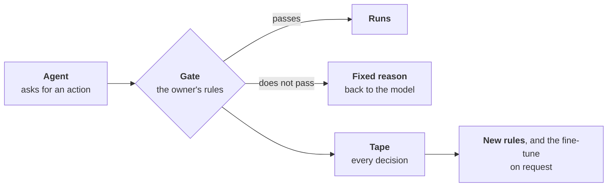

<p align="center">
  <a href="https://splabs.io"></a>
</p>

<p align="center">
  <a href="https://splabs.io"></a>
  <a href="https://splabs.io/lab"></a>
  <a href="ARTICLES.md"></a>
  <a href="results/"></a>
  <a href="https://github.com/SiliconPsycheLabs/gate"></a>
  <a href="https://huggingface.co/SiliconPsycheLabs"></a>
  <a href="LICENSE"></a>
</p>

# Silicon Psyche Labs

**A model does not break, it drifts.** It caves when a user insists, agrees with a wrong answer to please, obeys an
order hidden in an email it was only asked to summarise. None of that can be removed from a model: it can be seen and
reduced, never taken out. In a chat that costs little. In an agent that pays, deletes, sends mail and changes access,
one wrong action costs money.

So we put a **deterministic gate** in front of every action an agent is about to take. The action is checked against
the owner's rules before it runs: it **passes**, or it **does not pass** with a fixed reason the model reads. Nothing
probabilistic decides: the same action on the same facts always gets the same answer, and every decision is counted.

The rules are drawn from what agents actually try. Where it pays, we also **audit** the company's own model from the
inside and **fine-tune** it on its own logged failures, so it runs into the rules less, and the gate's count shows by
how much.

This repository is where we publish what can be checked from the outside: the numbers behind every article we
write. The gate's engine and its SDK are open source in
[SiliconPsycheLabs/gate](https://github.com/SiliconPsycheLabs/gate).

---

## How it works



| Step | What happens | What you get |
|---|---|---|
| **Gate** | Every action (a tool call, a SQL statement, a shell line, a mail, an API request) is read against one table of rules per agent, and against the company's own records: the state of an invoice, who is acting, the time. What is not in the table does not pass. | A ceiling on what an agent can do, the same answer every time, and a model that reads why. |
| **Tape** | Every decision is recorded with the rule that gave it. | The count of what passed and what did not, and the rules to write next. |
| **Audit and fine-tune**, on request | We run the company's own tasks and our attack library against its model, read what happens inside it, and tune it on its own failures. | Fewer blocked actions, fewer retries, maybe a smaller model, measured by the same count. |

A planted instruction can make a model want anything. With the gate, it can do only what the owner's rules allow.

---

## Selected results

Figures as published in the articles.

| What we measured | Result | Article |
|---|---|---|
| The rules rewritten as tables read by one engine, replayed on every recorded decision | 1,142,215 decisions, 0 differences from the rules they replaced | [Gate 2.0](https://splabs.io/lab/gate-2-rules-as-tables) |
| Twenty real systems as judges of the tables written from their own rule languages (PostgreSQL 16 grants, for example) | 39,721 of 39,721 actions that had to pass passed; 80,279 of 80,279 that must not pass did not | [Real systems check the gate](https://splabs.io/lab/real-systems-check-the-gate) |
| Four open models running small companies while planted messages pushed them to cause damage | with the gate, 0 runs ended in harm in about 48,000; without it, up to 2 attacked runs in 3 | [No harm behind the gate](https://splabs.io/lab/no-harm-behind-the-gate-in-48000-runs) |
| One job split among several agents, the gate reading the company's records | 429,285 of 429,285 actions that had to pass passed; none of 917,550 that must not | [numbers](results/why-the-gate-keeps-no-memory/) |
| Two payments asked at the same instant, with a limit of 3 per round | 7.8 made on average with no order kept, 3 with the order kept | [numbers](results/simultaneous-actions-kept-in-order/) |
| Stripe's own API description turned into rules with no hand-written rule, judged by Stripe in test mode | about 97 requests in 100 answered as Stripe answers them, work in progress | [numbers](results/stripe-rules-from-its-own-document/) |

---

## What we learned reading models

Before the gate, we spent months reading models' behaviour, from their output and from their internal states:
caving under pressure, sycophancy, planted orders, false reports of work done. Those articles are kept in
[`ARTICLES.md`](ARTICLES.md). They are why we build the gate: every one of those behaviours could be measured and
reduced, and none could be removed. They are also what the audit of a company's model starts from.

---

## Latest from the lab

<!--latest:start-->
- **[661 real agent calls: what rules can stop, and where a decision model helps](https://splabs.io/lab/the-gate-on-661-real-agent-calls)**  
  <sub>2026-11-25 · [numbers](results/the-gate-on-661-real-agent-calls/)</sub>  
  On the calls decision models are compared on, closing what is not listed let no bad call through. Those lessons are now how the whole gate works.

- **[A town of agents, run twice: once through the gate, once without](https://splabs.io/lab/a-town-of-agents-through-the-gate)**  
  <sub>2026-11-25 · [numbers](results/a-town-of-agents-through-the-gate/)</sub>  
  Ten agents ran a small town's economy for 48 days, twice. Through the gate nothing reached the fraudster, and what still got through showed which facts a rule must read.

- **[The gate's SDK is public: put the gate in front of your agent in a few lines](https://splabs.io/lab/the-gate-sdk-is-public)**  
  <sub>2026-11-24</sub>  
  The piece that connects an agent to the gate is now open source, for Python functions, OpenAI-style APIs, LangChain, the OpenAI Agents SDK, CrewAI, MCP servers and coding agents.

- **[One gate for every kind of agent: MCP, function calling, coding assistants, frameworks](https://splabs.io/lab/one-gate-for-every-kind-of-agent)**  
  <sub>2026-11-24</sub>  
  Every action of an agent now reaches the gate before it runs, whether the agent is a coding assistant, an MCP app, a program calling a model directly or a framework.

- **[Decoys: when the gate stops an attacker, it can answer with a fake](https://splabs.io/lab/decoys-in-the-gate)**  
  <sub>2026-11-24 · [numbers](results/decoys-in-the-gate/)</sub>  
  A rule that stops an action can now answer with a fake result the owner wrote, and a fake key it hands out stops any action that later uses it.

- **[A payment API's rules, read from its own published description and checked against the API itself](https://splabs.io/lab/stripe-rules-from-its-own-document)**  
  <sub>2026-11-24 · [numbers](results/stripe-rules-from-its-own-document/)</sub>  
  We turned Stripe's published API description into gate rules with no hand-written rule, then asked Stripe itself about 17,000 requests per round. They agree on about 97 in 100.
<!--latest:end-->

All articles with numbers: [`results/`](results/).

---

## What is in this repository

```
splabs/
├── ARTICLES.md        every article we have published, by section, with a one-line summary
├── results/           one folder per article that shows numbers
│   └── <article>/     README.md (the tables, readable) + numbers.json (the same, machine-readable)
└── assets/            images used by this page
```

---

## Put the gate in front of your agent

```bash
pip install "git+https://github.com/SiliconPsycheLabs/gate"
```

```python
from splabs_gate import Gate          # GATE_TOKEN: a gate key from your account on splabs.io

gate = Gate(table="payments", session="task-1842", agent="billing")
d = gate.decide("pay_invoice", {"number": "INV-0042"})
if d.passes:
    pay_invoice("INV-0042")
    gate.ran(d)
else:
    tell_the_model(d.reason)
```

Adapters for Python functions, OpenAI-style function calling, LangChain and LangGraph, the OpenAI Agents SDK,
CrewAI, MCP servers, and hooks for Claude Code, Codex CLI and Cursor: see the
[gate README](https://github.com/SiliconPsycheLabs/gate#readme). The table format, and the engine to run the rules
yourself, are in the same repository.

---

## Models

Models from our research are on [Hugging Face](https://huggingface.co/SiliconPsycheLabs).

## What we publish, and what we keep

We publish the aggregate figures of every result, the method and its limits, so anyone can check what we claim. The
gate's engine and SDK are open source. We keep private the rules we maintain, the test items (a published test is a
burned test), the training data and the fine-tuning recipes. Every article says which public benchmarks it used, so
the outside parts can be reproduced.

## Contact

- Site: [splabs.io](https://splabs.io) · From the lab: [splabs.io/lab](https://splabs.io/lab)
- To put the gate in front of your agents, or to have your model audited or fine-tuned:
  [splabs.io/products/gate](https://splabs.io/products/gate)

## License

Any code in this repository is under the [Apache License 2.0](LICENSE). Article texts and figures are © Silicon Psyche Labs: quote them with a link to the article.
